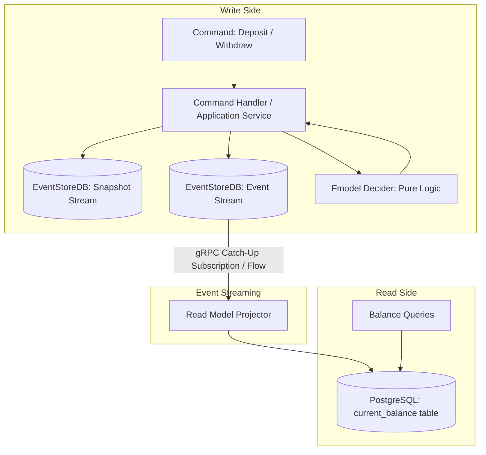
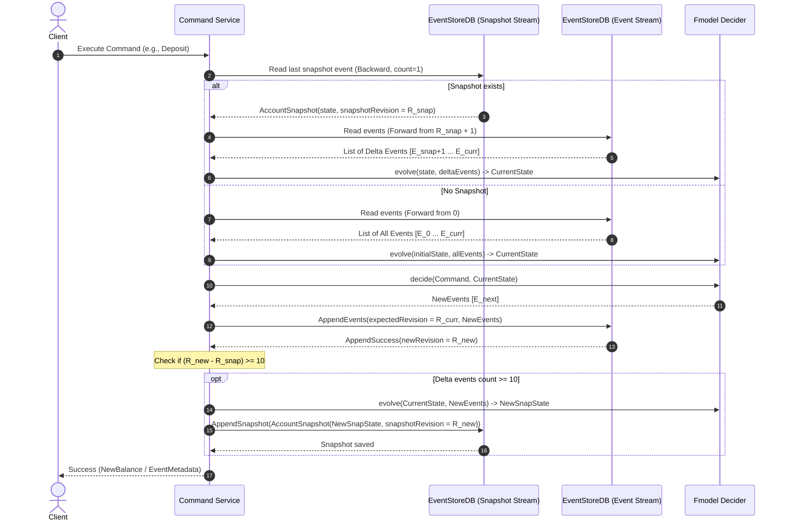

# Technical Specification: Bank Account Event Sourcing & CQRS with Fmodel

## 1. Overview & Architecture Summary

This project implements a minimal, robust Bank Account application adhering strictly to **Purely Functional Domain-Driven Design (DDD)**, **Event Sourcing (ES)**, and **Command Query Responsibility Segregation (CQRS)** using Kotlin and the [`fmodel`](https://fraktalio.com/fmodel/) library.

### Architectural Principles
- **Functional Core, Imperative Shell**: Domain logic is defined entirely as pure functions (`Decider`). No side-effects, mutable state, or I/O within the domain model.
- **Strict CQRS Separation**:
  - **Write Side**: Interacts exclusively with **EventStoreDB**. No persistent current state or aggregate tables exist on the write side.
  - **Read Side**: Interacts exclusively with **PostgreSQL**. An asynchronous projection engine consumes committed events from EventStoreDB and updates read-optimized query tables.
- **Snapshotting**: To avoid unbounded replay of events on high-throughput accounts, snapshots are generated when an account stream grows by 10 or more events. State reconstitution restores the latest snapshot and replays only subsequent delta events.



---

## 2. Infrastructure Specification

The application will run against Dockerized instances of EventStoreDB and PostgreSQL.

### `docker-compose.yml` Configuration
- **EventStoreDB**:
  - Image: `eventstore/eventstore:24.10.0-lts-bookworm-slim` (or `23.10.0-jammy`)
  - Ports: `2113:2113` (HTTP & gRPC)
  - Environment:
    - `EVENTSTORE_CLUSTER_SIZE=1`
    - `EVENTSTORE_RUN_PROJECTIONS=All`
    - `EVENTSTORE_START_STANDARD_PROJECTIONS=true`
    - `EVENTSTORE_INSECURE=true` (No TLS, development mode)
    - `EVENTSTORE_ENABLE_ATOM_PUB_OVER_HTTP=true`
- **PostgreSQL**:
  - Image: `postgres:16-alpine`
  - Ports: `5432:5432`
  - Environment:
    - `POSTGRES_DB=bank_account_read_model`
    - `POSTGRES_USER=postgres`
    - `POSTGRES_PASSWORD=postgres`
  - Volume: Persistent local volume for read model data.

---

## 3. Domain Model (`fmodel`)

The domain logic is modeled as a functional `Decider` using `fmodel`.

### 3.1 Domain Types

```kotlin
// Identifier
@JvmInline
value class AccountId(val value: String)

// State
@Serializable
data class AccountState(
    val accountId: AccountId? = null,
    val balance: BigDecimal = BigDecimal.ZERO,
    val isInitialized: Boolean = false
)

// Commands
sealed interface AccountCommand {
    val accountId: AccountId

    data class Deposit(
        override val accountId: AccountId,
        val amount: BigDecimal
    ) : AccountCommand

    data class Withdraw(
        override val accountId: AccountId,
        val amount: BigDecimal
    ) : AccountCommand
}

// Events
@Serializable
sealed interface AccountEvent {
    val accountId: AccountId
    val amount: BigDecimal

    @Serializable
    data class Deposited(
        override val accountId: AccountId,
        override val amount: BigDecimal
    ) : AccountEvent

    @Serializable
    data class Withdrawn(
        override val accountId: AccountId,
        override val amount: BigDecimal
    ) : AccountEvent
}
```

### 3.2 Pure Business Rules & Invariants
1. `amount` must always be strictly greater than `BigDecimal.ZERO`.
2. `Withdraw`: If `amount > balance`, reject with `InsufficientFundsException` or return empty event list / error result.
3. First command automatically initializes the account. Subsequent commands mutate balance via event folding.

### 3.3 The Fmodel Decider

```kotlin
val accountDecider: Decider<AccountCommand, AccountState, AccountEvent> = Decider(
    initialState = AccountState(),
    decide = { command, state ->
        when (command) {
            is AccountCommand.Deposit -> {
                require(command.amount > BigDecimal.ZERO) { "Deposit amount must be positive" }
                listOf(AccountEvent.Deposited(command.accountId, command.amount))
            }
            is AccountCommand.Withdraw -> {
                require(command.amount > BigDecimal.ZERO) { "Withdrawal amount must be positive" }
                if (state.balance < command.amount) {
                    throw InsufficientFundsException("Insufficient funds: current balance is ${state.balance}, requested ${command.amount}")
                }
                listOf(AccountEvent.Withdrawn(command.accountId, command.amount))
            }
        }
    },
    evolve = { state, event ->
        when (event) {
            is AccountEvent.Deposited -> state.copy(
                accountId = event.accountId,
                balance = state.balance.add(event.amount),
                isInitialized = true
            )
            is AccountEvent.Withdrawn -> state.copy(
                accountId = event.accountId,
                balance = state.balance.subtract(event.amount),
                isInitialized = true
            )
        }
    }
)
```

---

## 4. Snapshotting Architecture & State Reconstitution

### 4.1 Requirement Breakdown
- **Threshold**: When the account event stream exceeds 10 events since the last snapshot (or since creation), calculate the current `AccountState` and persist a snapshot.
- **Loading Flow**:
  1. Retrieve the latest Snapshot for the account.
  2. If a snapshot exists, note its `snapshotRevision` (the event revision of the stream at which the snapshot was taken).
  3. Load only the events from the primary stream starting at `snapshotRevision + 1` up to the current stream tip.
  4. Evolve the snapshot state with the delta events.
  5. If no snapshot exists, fold all events starting from revision `0` over `initialState`.

### 4.2 Snapshot Storage in EventStoreDB
To adhere strictly to EventStoreDB as the write storage:
- **Primary Event Stream**: `account-{accountId}`
- **Snapshot Stream**: `account-{accountId}-snapshots`
- **Snapshot Payload**:
```kotlin
@Serializable
data class AccountSnapshot(
    val state: AccountState,
    val snapshotRevision: Long,
    val timestamp: Instant
)
```

### 4.3 Command Execution & Snapshotting Lifecycle



---

## 5. EventStoreDB Write Side Integration

- **Client**: `EventStoreDBClient` (Official Java SDK using gRPC, communicating over port `2113` insecurely).
- **Serialization**: `kotlinx.serialization.json.Json` with explicit event type mapping in metadata / event type header.
- **Optimistic Concurrency**:
  - `AppendToStreamOptions.expectedRevision(ExpectedRevision.expectedRevision(currentRevision))` ensures serial consistency and prevents lost updates during concurrent writes.

---

## 6. CQRS Read Model & PostgreSQL Projection Service

### 6.1 Database Schema (PostgreSQL)

```sql
CREATE TABLE IF NOT EXISTS current_balance (
    account_id VARCHAR(64) PRIMARY KEY,
    balance NUMERIC(19, 4) NOT NULL DEFAULT 0.0000,
    last_event_revision BIGINT NOT NULL,
    updated_at TIMESTAMP WITH TIME ZONE NOT NULL DEFAULT NOW()
);

CREATE TABLE IF NOT EXISTS projection_checkpoint (
    projection_name VARCHAR(64) PRIMARY KEY,
    last_processed_position BIGINT NOT NULL,
    updated_at TIMESTAMP WITH TIME ZONE NOT NULL DEFAULT NOW()
);
```

### 6.2 Subscription Mechanism
- Subscribes to EventStoreDB `$all` stream or individual account category streams (`$ce-account`) via **Catch-Up Subscription** (`SubscribeToAllOptions` with `Position.START` or last saved checkpoint).
- For each event:
  1. Deserialize `AccountEvent`.
  2. Transactionally update `current_balance`:
     ```sql
     INSERT INTO current_balance (account_id, balance, last_event_revision, updated_at)
     VALUES (:accountId, :deltaBalance, :revision, NOW())
     ON CONFLICT (account_id) DO UPDATE SET
         balance = CASE 
             WHEN :eventType = 'Deposited' THEN current_balance.balance + :amount
             WHEN :eventType = 'Withdrawn' THEN current_balance.balance - :amount
             ELSE current_balance.balance
         END,
         last_event_revision = EXCLUDED.last_event_revision,
         updated_at = NOW()
     WHERE current_balance.last_event_revision < EXCLUDED.last_event_revision;
     ```
  3. Update `projection_checkpoint` position.

### 6.3 Read Queries
Read operations query PostgreSQL directly:
- `getBalance(accountId: AccountId): CurrentBalanceView?`

---

## 7. Technology Stack & Dependencies

| Component | Library / Framework | Purpose |
|---|---|---|
| Build System | **Apache Maven 3.9+** (`pom.xml`) | `kotlin-maven-plugin`, `kotlinx-serialization` plugin, surefire/failsafe |
| Language & Runtime | Kotlin 2.x / JVM 21 | Functional, expressive, null-safe language |
| Pure Domain / Decider | `org.fraktalio.fmodel:fmodel-core` | Formal Decider & functional event sourcing DSL |
| Event Store | `com.eventstore:eventstoredb-client` (v5.x+) | Write store, gRPC client, catch-up subscription |
| Database Driver & Query | `org.postgresql:postgresql` + `HikariCP` + `Exposed` (or lightweight JDBC template) | Read-side projections and queries |
| Concurrency & Streams | `kotlinx-coroutines-core` & Coroutine Flow | Reactive catch-up event processing |
| Serialization | `kotlinx-serialization-json` | High performance JSON serialization |
| Testing | `JUnit 5`, `MockK`, `Kotest Assertions`, `Testcontainers` (EventStoreDB & PostgreSQL) | Functional decider testing & integration testing |

---

## 8. Verification & Test Plan

1. **Unit Tests (Pure Decider)**:
   - Initial state behavior.
   - Deposit increments balance.
   - Withdraw decrements balance.
   - Withdraw exceeding balance throws/fails.
   - Negative amounts fail preconditions.
2. **Snapshot Logic Tests**:
   - Write 9 events -> Verify snapshot stream is empty; reconstitution reads 9 events.
   - Write 10th and 11th event -> Verify snapshot is written with `snapshotRevision = 10` (or 11).
   - Reconstitution on 11th event loads snapshot at revision 10 and only 1 delta event from primary stream.
3. **CQRS Projection Integration Tests**:
   - Send sequence of deposits and withdrawals.
   - Verify projection subscriber processes events and updates PostgreSQL `current_balance`.
   - Query balance from PostgreSQL read service and verify consistency.
